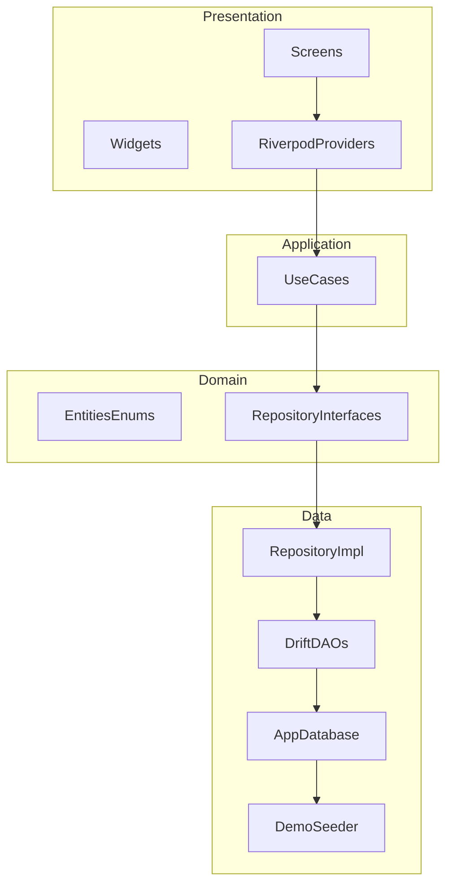
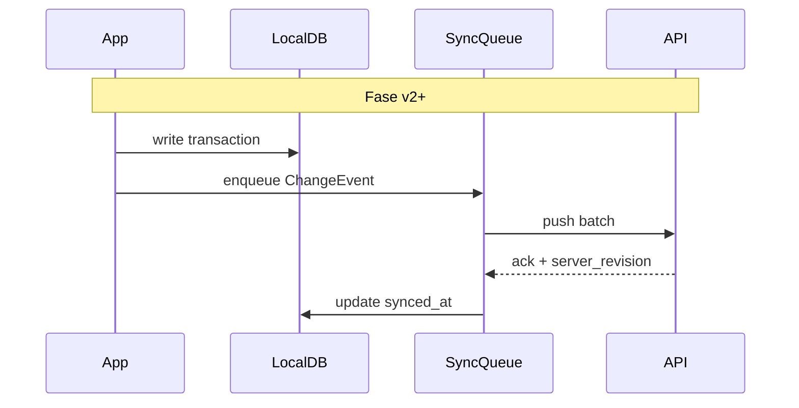

# Architecture Document
# Cashier Point of Sales F&B — Flutter MVP

| Field | Value |
|-------|--------|
| **Related** | [PRD.md](PRD.md) |
| **Version** | 1.0 |
| **Last updated** | 2026-11-02 |

---

## 1. Tujuan dokumen

Mendefinisikan arsitektur teknis MVP: lapisan aplikasi, schema SQLite (Drift), alur data, dan konvensi yang **sync-ready** untuk integrasi backend services di fase mendatang — tanpa memanggil network di MVP.

---

## 2. Stack teknis

| Layer | Pilihan | Alasan |
|-------|---------|--------|
| UI | Flutter 3.x, **Material 3** | PRD NFR; satu codebase iOS/Android |
| State | **Riverpod** (`flutter_riverpod`) | Testable, cocok dengan repository + async DB |
| Navigation | **go_router** | Deep link siap; tab shell Kasir/Menu/Laporan/Settings |
| Database | **Drift** 2.x on **SQLite** | Relational, migrasi, type-safe queries |
| IDs | **UUID v4** (package `uuid`) | Stabil untuk sync backend |
| Money / locale | `intl` | Format `Rp` (`id_ID`) |
| Share struk | `share_plus` + `pdf` / widget capture (fase UI) | PRD US-04 |

Dev tooling: `drift_dev` + `build_runner` untuk code generation.

---

## 3. Arsitektur lapisan



### 3.1 Aturan dependensi

- `presentation` → `application` → `domain` ← `data` (implementasi interface di `data`).
- **Domain** tidak import Flutter/Drift.
- Transaksi checkout: satu **Drift transaction** (SQL) untuk insert `transactions` + `transaction_lines`, lalu commit sebelum navigasi ke struk.

### 3.2 Struktur folder (lib/)

```
lib/
  main.dart
  app.dart                    # MaterialApp + router
  core/
    constants/
    extensions/
    utils/                    # currency_format, transaction_number
  domain/
    entities/                 # Category, Product, SaleTransaction, ...
    enums/                    # OrderType, PaymentMethod, TransactionStatus
    repositories/             # abstract repos
  data/
    local/
      database/
        app_database.dart
        tables/
        daos/
      seed/
        demo_seeder.dart
    repositories/             # *RepositoryImpl
  application/
    use_cases/                # checkout, void_transaction, delete_demo_products, ...
  presentation/
    routing/
      app_router.dart
    shell/
      main_shell.dart         # bottom nav
    features/
      cashier/
      menu/
      reports/
      settings/
    shared/                   # money_text, confirm_dialog, ...
```

Generated: `lib/data/local/database/*.g.dart` (Drift).

---

## 4. Schema SQLite (Drift)

Semua PK string = UUID. Timestamp disimpan **UTC** (`DateTime` drift) kecuali laporan harian difilter dengan timezone perangkat (konversi di query/use case).

### 4.1 Tabel `categories`

| Column | Type | Notes |
|--------|------|--------|
| `id` | TEXT PK | UUID |
| `name` | TEXT NOT NULL | |
| `sort_order` | INTEGER NOT NULL DEFAULT 0 | |
| `created_at` | INTEGER NOT NULL | ms since epoch UTC |
| `updated_at` | INTEGER NOT NULL | |
| `synced_at` | INTEGER NULL | reserved MVP |
| `server_revision` | INTEGER NULL | reserved MVP |

### 4.2 Tabel `products`

| Column | Type | Notes |
|--------|------|--------|
| `id` | TEXT PK | UUID |
| `category_id` | TEXT NOT NULL FK → categories.id | ON DELETE RESTRICT |
| `name` | TEXT NOT NULL | |
| `price` | INTEGER NOT NULL | Rupiah, ≥ 1 |
| `is_active` | INTEGER NOT NULL DEFAULT 1 | bool |
| `is_demo` | INTEGER NOT NULL DEFAULT 0 | bool |
| `created_at` | INTEGER NOT NULL | |
| `updated_at` | INTEGER NOT NULL | |
| `synced_at` | INTEGER NULL | |
| `server_revision` | INTEGER NULL | |

Index: `products(category_id)`, `products(is_active)`.

### 4.3 Tabel `transactions`

| Column | Type | Notes |
|--------|------|--------|
| `id` | TEXT PK | UUID internal |
| `display_number` | TEXT NOT NULL UNIQUE | Human-readable, e.g. `TRX-20261102-001` |
| `created_at` | INTEGER NOT NULL | |
| `order_type` | TEXT NOT NULL | `dine_in` \| `takeaway` |
| `status` | TEXT NOT NULL | `completed` \| `voided` |
| `voided_at` | INTEGER NULL | set when voided |
| `subtotal` | INTEGER NOT NULL | |
| `total` | INTEGER NOT NULL | MVP = subtotal |
| `payment_method` | TEXT NOT NULL | `cash` |
| `amount_paid` | INTEGER NOT NULL | |
| `change_amount` | INTEGER NOT NULL | |
| `synced_at` | INTEGER NULL | |
| `server_revision` | INTEGER NULL | |

Index: `transactions(created_at)`, `transactions(status)`.

**Omzet harian**: `SUM(total) WHERE status = 'completed' AND created_at in local day range`.

### 4.4 Tabel `transaction_lines`

| Column | Type | Notes |
|--------|------|--------|
| `id` | TEXT PK | UUID |
| `transaction_id` | TEXT NOT NULL FK → transactions.id | ON DELETE CASCADE |
| `product_id` | TEXT NULL FK → products.id | ON DELETE SET NULL |
| `product_name_snapshot` | TEXT NOT NULL | |
| `unit_price_snapshot` | INTEGER NOT NULL | |
| `qty` | INTEGER NOT NULL | ≥ 1 |
| `line_total` | INTEGER NOT NULL | |

Index: `transaction_lines(transaction_id)`.

### 4.5 Tabel `app_settings` (single row)

| Column | Type | Notes |
|--------|------|--------|
| `id` | INTEGER PK | always `1` |
| `outlet_name` | TEXT NOT NULL DEFAULT 'Outlet Saya' | |
| `receipt_footer` | TEXT NULL | max 200 di UI |
| `db_seeded_at` | INTEGER NULL | first demo seed timestamp |
| `updated_at` | INTEGER NOT NULL | |

### 4.6 Tabel `schema_meta` (opsional)

| Column | Type | Notes |
|--------|------|--------|
| `key` | TEXT PK | e.g. `last_display_number_date` |
| `value` | TEXT NOT NULL | counter state for TRX numbers |

Alternatif: derive counter dari query `MAX(display_number)` per hari — pilih satu pendekatan saat implementasi (disarankan `schema_meta` untuk race-free).

### 4.7 Migrasi

- `schemaVersion` dimulai **1** dengan seluruh tabel di atas.
- Setiap perubahan schema → increment + migration step Drift.
- Backend phase: migration menambah kolom sync tanpa breaking MVP clients (nullable columns).

---

## 5. Domain enums

```dart
enum OrderType { dineIn, takeaway }
enum TransactionStatus { completed, voided }
enum PaymentMethod { cash }
```

Mapping DB: `dine_in`, `takeaway`, `completed`, `voided`, `cash`.

---

## 6. Use cases utama (Application)

| Use case | Input | Output / efek |
|----------|--------|----------------|
| `InitializeApp` | — | Buka DB, seed demo jika kosong, ensure settings row |
| `WatchActiveProducts` | categoryId? | Stream produk aktif untuk kasir |
| `CheckoutCash` | cart lines, orderType, amountPaid | SQL txn → transaction + lines |
| `VoidTransaction` | transactionId | status → voided, voided_at |
| `GetDailyReport` | localDate | counts, omzet, list |
| `DeleteDemoProducts` | — | DELETE products WHERE is_demo = 1 |
| CRUD category/product | … | Validasi PRD US-05 |

**Keranjang (cart)** MVP: in-memory di Riverpod `Notifier` (session scope), tidak persisten — sesuai PRD (kehilangan cart saat kill acceptable; transaksi selesai wajib persist).

---

## 7. Nomor transaksi (`display_number`)

Format: `TRX-{yyyyMMdd}-{seq}` dengan `seq` 3 digit zero-padded per hari kalender **local**.

Algoritme ( dalam SQL transaction checkout):

1. Lock / baca counter hari dari `schema_meta` atau hitung max seq untuk tanggal.
2. Increment seq.
3. Insert transaction dengan `display_number` unik.

Internal PK tetap UUID untuk sync.

---

## 8. Demo seeder

Trigger: `InitializeApp` setelah migrasi, jika `categories` count = 0.

1. Insert 2 categories (Minuman, Makanan).
2. Insert ≥ 5 products dengan `is_demo = true`.
3. Set `app_settings.db_seeded_at`.

**Hapus data demo**: delete from `products` where `is_demo = 1` (categories demo boleh tetap atau dihapus jika kosong — implementasi: hapus produk demo saja; kategori tanpa produk boleh di-clean optional).

Seeder idempotent: tidak re-run if categories exist.

---

## 9. Presentation & routing

### 9.1 Shell routes

| Path | Tab | Feature |
|------|-----|---------|
| `/cashier` | Kasir | Grid menu + cart sheet |
| `/menu` | Menu | CRUD produk/kategori |
| `/reports` | Laporan | KPI + list + detail + void |
| `/settings` | Pengaturan | Outlet, footer, hapus demo |

Checkout: modal/sheet on `/cashier` atau sub-route `/cashier/checkout`.

Receipt: `/cashier/receipt/:id` (post-checkout).

### 9.2 Provider scope

- `appDatabaseProvider` — singleton
- Repository providers per interface
- Feature providers scoped to screen where possible

---

## 10. Sync-ready (fase backend — tidak diimplementasi MVP)



Rekomendasi persiapan MVP:

- Kolom `synced_at`, `server_revision` on mutable entities.
- Hindari hard delete transaksi (void only) — sudah PRD.
- Repository sebagai boundary — nanti tambah `RemoteDataSource` di belakang impl yang sama.

Tabel `sync_outbox` **tidak** dibuat di MVP (cukup nullable columns).

---

## 11. Testing strategy

| Level | Target |
|-------|--------|
| Unit | Use cases: checkout math, void excludes omzet, display_number seq |
| Drift | In-memory database (`NativeDatabase.memory()`) for repo integration |
| Widget | Checkout validation, empty cart |
| Golden | Struk layout (optional) |

---

## 12. Security & privacy (MVP)

- Data hanya di SQLite file app sandbox.
- No secrets in repo; no API keys MVP.
- Optional later: SQLCipher — out of scope MVP.

---

## 13. Implementasi — urutan sprint disarankan

1. Drift schema + migrasi v1 + `InitializeApp` + seeder  
2. Settings + format currency  
3. Menu CRUD (US-05)  
4. Kasir + cart + checkout (US-01–04, US-09)  
5. Laporan + void (US-06, US-10)  
6. Share struk (US-04)  
7. Hapus data demo (US-11) + polish  

---

## 14. Referensi dependency (pubspec)

```yaml
dependencies:
  flutter:
    sdk: flutter
  flutter_riverpod: ^2.x
  go_router: ^14.x
  drift: ^2.x
  sqlite3_flutter_libs: ^0.5.x
  path_provider: ^2.x
  path: ^1.x
  uuid: ^4.x
  intl: ^0.19.x
  share_plus: ^10.x

dev_dependencies:
  drift_dev: ^2.x
  build_runner: ^2.x
  flutter_test:
    sdk: flutter
  flutter_lints: ^5.x
```

Versi exact pin saat `flutter pub add` pada setup proyek.

---

*End of Architecture Document*
