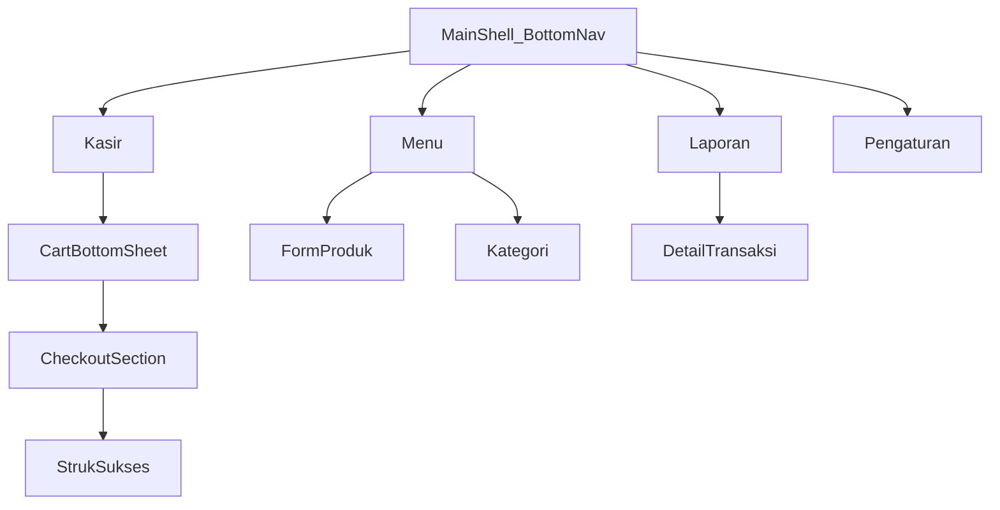

# Design Document (UI/UX)
# Cashier Point of Sales F&B — Flutter MVP

| Field | Value |
|-------|--------|
| **Related** | [PRD.md](PRD.md) · [ARCHITECTURE.md](ARCHITECTURE.md) |
| **Version** | 1.0 |
| **Platform** | Flutter · Material 3 |
| **Bahasa UI** | Indonesia (`id_ID`) |
| **Last updated** | 2026-11-02 |

---

## 1. Tujuan desain

1. **Kecepatan kasir** — minim tap untuk transaksi umum; area sentuh besar; informasi penting selalu terlihat (total keranjang, tombol bayar).
2. **Kejelasan di counter terang** — kontras tinggi, tipografi terbaca, tidak bergantung warna saja untuk status.
3. **Konsistensi** — komponen reusable; pola navigasi predictable di empat tab utama.
4. **Implementability** — spesifikasi cukup untuk Flutter (theme tokens, widget mapping, copy final).

---

## 2. Prinsip UX

| Prinsip | Implementasi |
|---------|----------------|
| Satu tangan / thumb zone | CTA utama (Bayar, Selesaikan) di bagian bawah; FAB menu di kanan bawah |
| Feedback instan | Snackbar singkat saat item masuk keranjang; animasi scale ringan pada tile menu |
| Cegah salah bayar | Uang kurang → tombol disabled + pesan inline; konfirmasi void & hapus demo |
| Offline-first | Tidak ada empty state “no connection”; loading hanya saat baca DB lokal |
| Aksesibilitas | Min touch **48dp**; `Semantics` pada total & Bayar; support text scale hingga 1.3× |

---

## 3. Visual identity

### 3.1 Arah brand (MVP)

Nuansa **hangat & profesional** (F&B): primary hijau-teh (fresh), surface netral, aksen amber untuk perhatian (void/warning). Bukan identitas final outlet — **nama outlet** dari Settings yang tampil di header/struk.

### 3.2 Color tokens (Material 3)

Gunakan `ColorScheme.fromSeed` dengan seed `#2D6A4F`, lalu override semantik:

| Token | Hex (light) | Pemakaian |
|-------|-------------|-----------|
| `primary` | `#2D6A4F` | AppBar tab, FAB, CTA Bayar |
| `onPrimary` | `#FFFFFF` | Teks pada primary |
| `secondary` | `#40916C` | Chip selected, link sekunder |
| `tertiary` | `#D4A373` | Badge demo, aksen hangat |
| `surface` | `#FAFAF8` | Background layar |
| `surfaceContainerHighest` | `#EEECE8` | Card menu, KPI |
| `error` | `#B3261E` | Validasi, void destructive |
| `outline` | `#79747E` | Border input, divider |

**Dark mode**: MVP **opsional** — jika diaktifkan, seed sama; prioritaskan light untuk UAT counter.

**Status void**: teks + badge `#6B7280` (abu) + strikethrough optional pada total di list.

### 3.3 Tipografi

Font sistem via Material (`TextTheme`):

| Style | Size / weight | Pemakaian |
|-------|----------------|-----------|
| `headlineSmall` | 24 / w600 | Omzet KPI |
| `titleLarge` | 22 / w600 | Total checkout |
| `titleMedium` | 16 / w600 | Nama menu tile |
| `bodyLarge` | 16 / w400 | Isi struk, list item |
| `bodyMedium` | 14 / w400 | Subcopy, waktu transaksi |
| `labelLarge` | 14 / w600 | Tombol, chip |
| **Money** | `titleMedium` + tabular figures | Semua nominal Rp (`FontFeature.tabularFigures()`) |

### 3.4 Spacing & shape

- Grid spacing: **8dp** base; padding layar **16dp**; antar section **24dp**.
- Menu grid: **2 kolom** phone portrait; `childAspectRatio` ~1.15 (nama 2 baris max + harga).
- Corner radius: card/tile **12dp**; sheet **16dp** top; button **12dp** (filled).

### 3.5 Iconografi

Material Symbols Outlined (default Flutter):

| Konteks | Icon |
|---------|------|
| Tab Kasir | `point_of_sale` |
| Tab Menu | `restaurant_menu` |
| Tab Laporan | `assessment` |
| Tab Pengaturan | `settings` |
| Keranjang | `shopping_cart` |
| Bagikan struk | `share` |
| Void | `block` / `cancel` |
| Demo badge | `science` atau label teks "Demo" |

---

## 4. Informasi arsitektur & navigasi

### 4.1 Struktur



### 4.2 Routing (selaras ARCHITECTURE)

| Route | Layar | Transisi |
|-------|--------|----------|
| `/cashier` | Kasir | Tab default |
| `/cashier/receipt/:id` | Struk | Push horizontal; back ke kasir kosong |
| `/menu` | Daftar produk | Tab |
| `/menu/product/new` | Tambah produk | Push |
| `/menu/product/:id` | Edit produk | Push |
| `/menu/categories` | Kelola kategori | Push |
| `/reports` | Laporan hari ini | Tab |
| `/reports/:id` | Detail + void | Push |
| `/settings` | Pengaturan | Tab |

**Bottom NavigationBar**: 4 item, `type: fixed`, label always show.

---

## 5. Spesifikasi layar

Setiap layar: **tujuan**, **wireframe ASCII**, **komponen**, **copy**, **edge cases**.

---

### 5.1 Kasir (`/cashier`)

**Tujuan**: US-01, US-02, US-08 — pilih menu cepat, lihat total, lanjut bayar.

```
┌─────────────────────────────────────┐
│ Warung Kopi Siti          🛒 3      │  ← AppBar: outletName, cart badge
├─────────────────────────────────────┤
│ [Semua][Minuman][Makanan]         │  ← FilterChip horizontal scroll
├─────────────────────────────────────┤
│ ┌──────────┐ ┌──────────┐         │
│ │ Kopi Susu│ │ Teh Manis│         │  ← Grid 2 kolom
│ │ Rp 18.000│ │ Rp 12.000│         │
│ └──────────┘ └──────────┘         │
│         ... scroll ...              │
├─────────────────────────────────────┤
│ Subtotal          Rp 54.000         │  ← Bottom bar sticky
│ [        Bayar        ]             │  ← FilledButton full width
└─────────────────────────────────────┘
```

| Elemen | Perilaku |
|--------|----------|
| Tile menu | Tap → tambah qty; ripple + snackbar "Kopi Susu ditambahkan" |
| Badge keranjang | Tap → buka **Cart bottom sheet** |
| Bayar | Enabled jika itemCount > 0; buka sheet fokus checkout |
| Chip Semua | Default selected |

**Empty state** (tidak ada produk aktif): ilustrasi sederhana + "Belum ada menu aktif" + tombol ke tab Menu.

---

### 5.2 Keranjang & checkout (bottom sheet)

**Tujuan**: US-02, US-03, US-09 — edit keranjang, tipe order, tunai.

Sheet: `DraggableScrollableSheet` initial 60%, max 95%.

```
┌─────────────────────────────────────┐
│ ─── handle ───                      │
│ Keranjang                           │
├─────────────────────────────────────┤
│ Kopi Susu  Rp18.000   [−] 2 [+] 🗑  │
│ Nasi Goreng Rp25.000  [−] 1 [+] 🗑  │
├─────────────────────────────────────┤
│ Subtotal              Rp 61.000     │
│ Total                 Rp 61.000     │
├─────────────────────────────────────┤
│ Tipe order                          │
│ ( Makan di tempat ) ( Bawa pulang ) │  ← SegmentedButton 2 opsi
├─────────────────────────────────────┤
│ Uang diterima                       │
│ [ Rp 100.000              ]         │  ← TextField numeric
│ Kembalian             Rp 39.000     │  ← live, primary color if ≥0
├─────────────────────────────────────┤
│ [   Selesaikan pembayaran   ]       │  ← disabled if uang < total
└─────────────────────────────────────┘
```

| Validasi | UI |
|----------|-----|
| Keranjang kosong | Sheet tidak dibuka dari Bayar (disabled) |
| Uang < total | Pesan "Uang kurang Rp X" di bawah field; CTA disabled |
| Processing | CTA loading indicator; block double tap |

Default segmented: **Makan di tempat** (`dine_in`).

---

### 5.3 Struk sukses (`/cashier/receipt/:id`)

**Tujuan**: US-04 — konfirmasi visual + share.

```
┌─────────────────────────────────────┐
│ ✓ Pembayaran berhasil               │
├─────────────────────────────────────┤
│ ┌─ ReceiptCard ─────────────────┐  │
│ │ WARUNG KOPI SITI               │  │
│ │ TRX-20261102-001               │  │
│ │ 02 Nov 2026, 14:32             │  │
│ │ Tipe: Makan di tempat          │  │
│ │ ─────────────────────────────  │  │
│ │ 2x Kopi Susu         Rp 36.000 │  │
│ │ 1x Nasi Goreng       Rp 25.000 │  │
│ │ ─────────────────────────────  │  │
│ │ Total                Rp 61.000 │  │
│ │ Tunai                Rp100.000 │  │
│ │ Kembalian            Rp 39.000 │  │
│ │ footer opsional                │  │
│ └────────────────────────────────┘  │
│ [ Bagikan ]  [ Transaksi baru ]     │
└─────────────────────────────────────┘
```

- **ReceiptCard**: background putih, border 1dp `#E5E7EB`, font struk `bodyLarge` dengan line height 1.35; nama outlet `titleMedium` center.
- **Bagikan**: capture card ke PNG/PDF → `share_plus`.
- **Transaksi baru**: `go` `/cashier`, clear cart.

---

### 5.4 Menu — daftar produk (`/menu`)

**Tujuan**: US-05

```
┌─────────────────────────────────────┐
│ Menu                        [Kat.] │  ← Icon button → categories
├─────────────────────────────────────┤
│ ● Kopi Susu    Minuman    Rp18.000 │  ← ListTile + trailing
│   [Aktif]                          │
│ ● Teh Manis    Minuman    Rp12.000 │
│   [Demo] [Nonaktif]                │
│         ...                         │
│                            [+] FAB  │
└─────────────────────────────────────┘
```

| Badge | Warna |
|-------|--------|
| Aktif | `secondary` container |
| Nonaktif | `outline` |
| Demo | `tertiary` container + label "Demo" |

FAB → `/menu/product/new`. Tap row → edit.

---

### 5.5 Form produk (new / edit)

| Field | Widget | Validasi |
|-------|--------|----------|
| Nama | TextField | Wajib, max 80 char |
| Harga | TextField Rp prefix | Wajib, integer > 0 |
| Kategori | Dropdown | Wajib |
| Aktif | Switch | Default on |

AppBar: Simpan (text button). Error inline di bawah field.

Dialog hapus: "Hapus menu ini?" → Cancel / Hapus (error color).

---

### 5.6 Kelola kategori (`/menu/categories`)

List kategori + sortOrder implicit (urutan insert / drag backlog v1.1).

- Tambah: inline TextField + tombol Tambah.
- Hapus: blocked jika masih ada produk → snackbar "Pindahkan atau hapus produk terlebih dahulu".

---

### 5.7 Laporan harian (`/reports`)

**Tujuan**: US-06

```
┌─────────────────────────────────────┐
│ Laporan hari ini                    │
│ Senin, 2 November 2026              │
├─────────────────────────────────────┤
│ ┌─────────────┐ ┌─────────────┐     │
│ │ 12          │ │ Rp 1,2 jt │     │  ← KPI cards
│ │ Transaksi   │ │ Omzet      │     │
│ └─────────────┘ └─────────────┘     │
├─────────────────────────────────────┤
│ 14:32  TRX-...-003  Takeaway  Rp45k │
│ 14:10  TRX-...-002  Dine-in   Rp61k │
│ 13:05  TRX-...-001  [Dibatalkan]    │  ← voided: muted + label
└─────────────────────────────────────┘
```

Omzet & count **hanya transaksi selesai** (completed).

Tap row → detail.

---

### 5.8 Detail transaksi (`/reports/:id`)

Mirror **ReceiptCard** (read-only) + metadata status.

| Status | Aksi |
|--------|------|
| completed | OutlinedButton destructive: **Batalkan transaksi** |
| voided | Banner abu: "Transaksi dibatalkan"; tanpa tombol void |

Dialog void: "Batalkan transaksi ini? Omzet harian akan berkurang." → Batal / Batalkan.

---

### 5.9 Pengaturan (`/settings`)

| Section | Konten |
|---------|--------|
| Outlet | TextField nama outlet |
| Struk | TextField footer (multiline max 3 lines) |
| Tampilan | `SwitchListTile` **Tema gelap** (terang/gelap, simpan langsung) |
| Data demo | ListTile "Hapus data demo" → dialog konfirmasi |
| Tentang | Versi app (read-only) |

Simpan: auto-save on blur atau tombol Simpan di AppBar — pilih **Simpan** eksplisit di AppBar untuk kejelasan.

Dialog hapus demo: "Semua menu bertanda Demo akan dihapus. Transaksi tidak terpengaruh."

---

## 6. Design system — komponen Flutter

| Komponen | Widget / wrapper | Catatan |
|----------|------------------|---------|
| `AppScaffold` | `Scaffold` + padding standar | |
| `MoneyText` | `Text` + format `intl` Rp | Shared di `presentation/shared/` |
| `MenuProductTile` | `InkWell` + `Card` | Kasir grid cell |
| `CartLineTile` | `ListTile` + stepper custom | Min 48dp buttons |
| `ReceiptCard` | `Container` + column | Dipakai struk & detail |
| `KpiCard` | `Card` + column | Laporan |
| `OrderTypeSegmented` | `SegmentedButton<OrderType>` | 2 segments |
| `PrimaryButton` | `FilledButton` min height 48 | |
| `ConfirmDialog` | `AlertDialog` | Void, hapus, demo |
| `EmptyState` | Column + icon + text + optional CTA | |

### 6.1 Theme setup (`app.dart`)

```dart
ThemeData(
  useMaterial3: true,
  colorScheme: ColorScheme.fromSeed(
    seedColor: Color(0xFF2D6A4F),
    brightness: Brightness.light,
  ),
  inputDecorationTheme: InputDecorationTheme(
    border: OutlineInputBorder(borderRadius: BorderRadius.circular(12)),
    filled: true,
  ),
  snackBarBehavior: SnackBarBehavior.floating,
)
```

`MaterialApp.router` + `locale: Locale('id', 'ID')`.

---

## 7. Copy deck (Indonesia)

| Key | Teks |
|-----|------|
| tab_cashier | Kasir |
| tab_menu | Menu |
| tab_reports | Laporan |
| tab_settings | Pengaturan |
| pay | Bayar |
| complete_payment | Selesaikan pembayaran |
| order_dine_in | Makan di tempat |
| order_takeaway | Bawa pulang |
| cash_received | Uang diterima |
| change | Kembalian |
| insufficient_cash | Uang kurang {amount} |
| payment_success | Pembayaran berhasil |
| share | Bagikan |
| new_transaction | Transaksi baru |
| void_transaction | Batalkan transaksi |
| void_confirm_title | Batalkan transaksi ini? |
| void_confirm_body | Omzet harian akan berkurang. |
| status_voided | Dibatalkan |
| delete_demo | Hapus data demo |
| empty_cart | Keranjang kosong |
| empty_products | Belum ada menu aktif |
| save | Simpan |

Placeholder amount: `{amount}` diganti `MoneyText`.

---

## 8. State & feedback

| State | Pola visual |
|-------|-------------|
| Loading DB | `CircularProgressIndicator` center, max 300ms skeleton backlog |
| Error DB | Full page "Gagal memuat data" + Coba lagi |
| Snackbar sukses | 2s floating — item ditambahkan, disimpan, void |
| Disabled CTA | `onSurface` 38% opacity + tidak haptic |

**Haptic**: `HapticFeedback.lightImpact()` saat item ditambahkan & pembayaran sukses (opsional iOS/Android).

---

## 9. Aksesibilitas

- Semua icon button: `tooltip` bahasa Indonesia.
- `Semantics(label: 'Total pesanan Rp ...')` pada bottom bar kasir.
- Segmented order type: announce perubahan selection.
- Kontras teks body on surface ≥ **4.5:1** (WCAG AA).
- Tidak mengandalkan warna merah saja untuk void — ada label "Dibatalkan".

---

## 10. Responsiveness

| Breakpoint | Perilaku |
|------------|----------|
| Phone narrow (<360dp) | Grid 2 kolom, font scale default |
| Phone wide / tablet | Grid 3–4 kolom; NavigationRail opsional backlog |
| Landscape kasir | Tetap 2 kolom min; bottom bar tetap |

MVP UAT fokus **phone portrait**.

---

## 11. Mapping PRD → desain

| User story | Layar / komponen |
|------------|------------------|
| US-01 | MenuProductTile, snackbar |
| US-02 | CartLineTile, sheet |
| US-03 | Checkout fields, PrimaryButton |
| US-04 | ReceiptCard, share |
| US-05 | Menu list, form, categories |
| US-06 | KpiCard, report list |
| US-07 | Settings form |
| US-08 | FilterChip row |
| US-09 | OrderTypeSegmented |
| US-10 | Detail + ConfirmDialog void |
| US-11 | Demo badge, hapus demo settings |

---

## 12. Out of scope desain MVP

- Ilustrasi custom brand / onboarding carousel
- Animasi Lottie
- Dark mode polish
- Tablet split-view kasir + keranjang side-by-side
- QRIS / metode bayar tambahan (placeholder chip disabled backlog)

---

## 13. Handoff ke engineering

1. Implement `ThemeData` + shared widgets (§6) sebelum feature screens.
2. Bangun **ReceiptCard** sekali; reuse struk + detail laporan.
3. Bottom sheet checkout: satu widget `CheckoutSheet` dengan state dari Riverpod cart provider.
4. Golden tests optional untuk `ReceiptCard` & `MoneyText`.

---

*End of Design Document*
