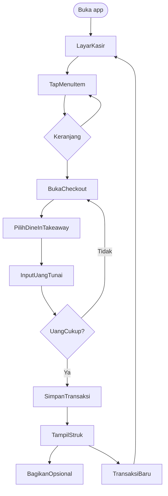
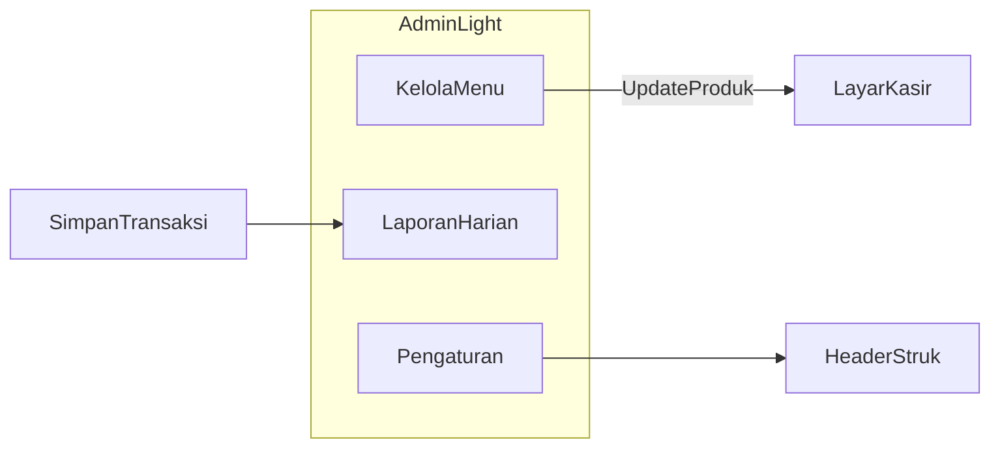
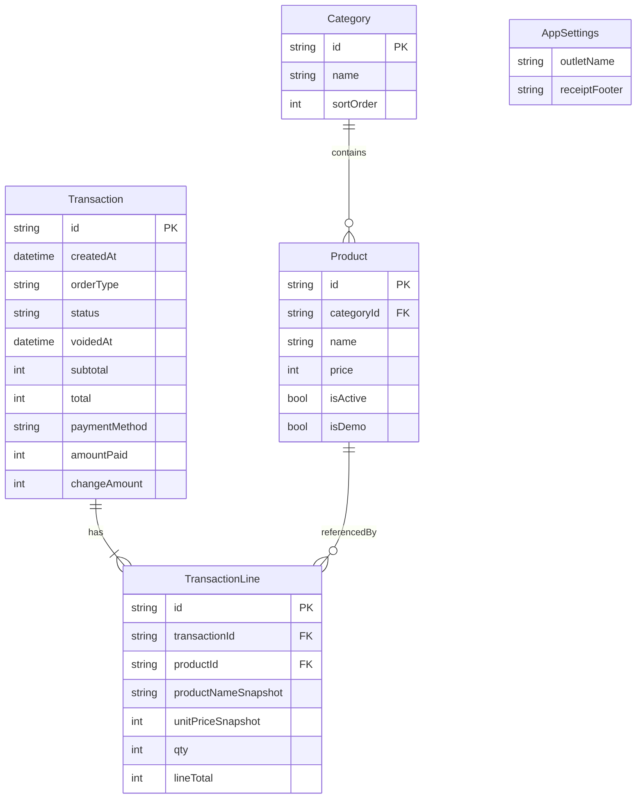
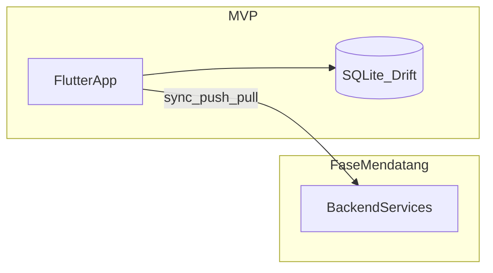

# Product Requirements Document (PRD)
# Aplikasi Point of Sales F&B — Flutter Mobile

| Field | Value |
|-------|--------|
| **Product** | Cashier Point of Sales (F&B) |
| **Platform** | Mobile — Flutter (iOS & Android) |
| **Version** | MVP v1.0 |
| **Status** | Draft — siap backlog engineering |
| **Last updated** | 2026-11-02 (revisi keputusan stakeholder) |

---

## 1. Ringkasan eksekutif

### 1.1 Latar belakang

Outlet F&B kecil (kafe, restoran, warung) sering masih mencatat penjualan secara manual atau dengan alat yang lambat saat jam sibuk. Akibatnya: antrian panjang, salah hitung, dan laporan harian yang harus dirangkai ulang dari catatan.

### 1.2 Visi produk

Menyediakan **aplikasi kasir mobile** yang cepat dipakai dengan satu tangan, **offline-first** dengan data di **SQLite lokal**, untuk input order (dine-in / takeaway), pembayaran tunai, struk, dan ringkasan penjualan harian. Integrasi **backend services** direncanakan pada fase setelah MVP.

### 1.3 Tujuan MVP

| Tujuan | Indikator |
|--------|-----------|
| Checkout cepat | Transaksi tipikal (1–5 item) selesai dalam **≤ 30 detik** setelah item dipilih |
| Data terpusat di perangkat | Semua transaksi tersimpan lokal; tidak hilang setelah app ditutup |
| Laporan harian tanpa export manual | Owner melihat omzet & jumlah transaksi **hari ini** di dalam app |

### 1.4 Non-goals (MVP)

Backend sync, multi-outlet, nomor meja, dapur (KDS), manajemen stok, payment gateway, dan backoffice web — lihat [§3 Ruang lingkup](#3-ruang-lingkup).

---

## 2. Persona & pengguna

### 2.1 Persona: Kasir (Budi)

- **Konteks**: Berdiri di counter; pelanggan menunggu; perlu tap cepat.
- **Kebutuhan**: Pilih menu, ubah qty, terima uang tunai, beri struk.
- **Frustrasi**: UI kecil, banyak langkah, app lambat atau crash saat sibuk.

### 2.2 Persona: Owner (Siti)

- **Konteks**: Mengelola menu dan mengecek omzet harian; sering memakai perangkat yang sama dengan kasir (MVP: **satu perangkat per outlet**).
- **Kebutuhan**: Tambah/ubah harga menu, nonaktifkan item habis, lihat laporan hari ini.
- **Frustrasi**: Tidak tahu omzet real-time tanpa menghitung manual.

### 2.3 Akses & role (MVP)

| Role | Kemampuan MVP |
|------|----------------|
| **Operator** (implicit) | Kasir + akses Menu + Laporan + Settings |
| Multi-user / login | **Out of scope** v1 — tidak ada autentikasi; proteksi perangkat via OS |

---

## 3. Ruang lingkup

### 3.1 In scope (MVP v1.0)

1. **Katalog menu** dengan **kategori** (contoh: Minuman, Makanan, Snack).
2. **Layar kasir**: daftar/grid menu (hanya item **aktif**), keranjang, subtotal, total.
3. **Keranjang**: tambah qty per tap item, +/- qty, hapus line item.
4. **Tipe order**: pilih **Dine-in** atau **Takeaway** saat checkout (tanpa nomor meja).
5. **Checkout tunai**: input *Uang diterima*; hitung kembalian; validasi uang ≥ total.
6. **Struk**: layar konfirmasi setelah bayar; **share** sebagai image atau PDF (system share sheet); tampilkan tipe order.
7. **Laporan harian**: tanggal = hari ini (timezone perangkat); jumlah transaksi, total omzet (hanya transaksi **aktif**), daftar transaksi.
8. **Hapus / void transaksi**: dari detail transaksi di laporan, dengan konfirmasi; transaksi void tidak masuk omzet.
9. **CRUD menu** (owner): nama, harga, kategori, status aktif/nonaktif.
10. **Settings minimal**: nama outlet (header struk), opsional baris footer struk.
11. **Database lokal SQLite** via **Drift** (keputusan MVP); schema dirancang agar mudah disinkronkan ke backend di fase mendatang (ID, `createdAt`, status).
12. **Seeder menu demo** saat **first install** (kategori + item contoh) agar onboarding cepat; dapat dihapus dari pengaturan atau diganti menu sendiri.

### 3.2 Out of scope (explicit)

| Area | Catatan |
|------|---------|
| Backend services (API sync, auth, backup cloud) | Fase pasca-MVP — lihat [§11 Roadmap](#11-roadmap-setelah-mvp) |
| Multi-outlet | Setelah integrasi backend |
| Nomor meja, reservasi, panggil antrian | v2+ (tipe dine-in/takeaway **tanpa meja** sudah in scope MVP) |
| Kitchen Display System (KDS) | v2+ |
| Stok bahan & resep | v2+ |
| Diskon, promo, voucher, membership | v2+ |
| Modifier menu (size, level gula, topping) | v1.1+ |
| Barcode / SKU-first retail | Bukan fokus F&B MVP |
| QRIS, kartu, payment gateway | v1.1+ (placeholder UI optional) |
| Pajak PPn / service charge otomatis | **Tidak** di MVP — lihat [§12 Keputusan produk](#12-keputusan-produk--open-questions) |
| Thermal printer Bluetooth/USB | Mitigasi: share struk; printer di v1.1 |
| Backoffice web | v2+ |
| Pencarian menu (search) | Nice-to-have; masuk backlog v1.1 jika sprint longgar |

### 3.3 Asumsi MVP

- Satu perangkat mobile per outlet; tidak ada dua kasir sinkron pada data yang sama (sampai backend tersedia).
- Semua harga dalam **IDR**, bilangan bulat (Rupiah tanpa desimal).
- Zona waktu laporan mengikuti **timezone perangkat**.
- MVP **tidak** memanggil network; struktur data mengantisipasi sync ke backend (UUID/ULID, timestamp UTC atau local + timezone).

---

## 4. User stories & acceptance criteria

### 4.1 Ringkasan

| ID | User story | Prioritas |
|----|------------|-----------|
| US-01 | Sebagai kasir, saya menambahkan item menu ke keranjang agar order tercatat | P0 |
| US-02 | Sebagai kasir, saya mengubah qty atau menghapus item agar order benar | P0 |
| US-03 | Sebagai kasir, saya menyelesaikan pembayaran tunai agar transaksi selesai | P0 |
| US-04 | Sebagai kasir, saya melihat struk setelah bayar agar bisa dibagikan ke pelanggan | P0 |
| US-05 | Sebagai owner, saya mengelola menu agar harga dan ketersediaan akurat | P0 |
| US-06 | Sebagai owner, saya melihat laporan penjualan hari ini agar tahu omzet | P0 |
| US-07 | Sebagai owner, saya mengatur nama outlet di struk agar branding jelas | P1 |
| US-08 | Sebagai kasir, saya memfilter menu per kategori agar cepat menemukan item | P1 |
| US-09 | Sebagai kasir, saya memilih dine-in atau takeaway agar jenis order tercatat | P0 |
| US-10 | Sebagai owner, saya menghapus (void) transaksi salah agar laporan omzet akurat | P0 |
| US-11 | Sebagai pengguna baru, saya mendapat menu demo saat pertama buka app agar bisa langsung coba | P0 |

### 4.2 US-01 — Tambah item ke keranjang

**Acceptance criteria**

- AC-01.1: Tap satu item menu menambah qty 1 di keranjang (atau menambah qty jika item sudah ada).
- AC-01.2: Keranjang menampilkan nama item, harga satuan, qty, dan line total per item.
- AC-01.3: Subtotal dan total order ter-update segera setelah perubahan keranjang.
- AC-01.4: Item dengan `isActive = false` tidak muncul di layar kasir.

**Skenario (Given / When / Then)**

| # | Given | When | Then |
|---|--------|------|------|
| S1 | Layar kasir menampilkan menu | Kasir tap "Kopi Susu" | Keranjang berisi 1× Kopi Susu; total = harga item |
| S2 | "Kopi Susu" sudah qty 2 di keranjang | Kasir tap "Kopi Susu" lagi | Qty menjadi 3; line total ter-update |
| S3 | Item "Teh Tarik" nonaktif | Kasir buka layar kasir | "Teh Tarik" tidak tampil |

### 4.3 US-02 — Ubah qty / hapus item

**Acceptance criteria**

- AC-02.1: Kasir dapat menaikkan/menurunkan qty dengan kontrol +/- (min qty 1 sebelum hapus).
- AC-02.2: Kasir dapat menghapus line item dari keranjang.
- AC-02.3: Total order selalu konsisten dengan Σ (unitPrice × qty).

**Skenario**

| # | Given | When | Then |
|---|--------|------|------|
| S1 | Keranjang qty 3 untuk satu item | Kasir tap − satu kali | Qty = 2; total berkurang sesuai harga |
| S2 | Satu line item di keranjang | Kasir hapus item | Keranjang kosong; total = 0 |
| S3 | Keranjang kosong | Kasir tap Checkout | Checkout tidak tersedia atau menampilkan pesan "Keranjang kosong" |

### 4.4 US-03 — Pembayaran tunai

**Acceptance criteria**

- AC-03.1: Layar checkout menampilkan total tagihan dan pilihan **Tipe order**: Dine-in / Takeaway (default: Dine-in).
- AC-03.2: Kasir memasukkan nominal *Uang diterima* (input numerik).
- AC-03.3: Jika uang diterima < total, tombol bayar disabled atau menampilkan error; transaksi **tidak** disimpan.
- AC-03.4: Jika uang diterima ≥ total, kembalian dihitung dan ditampilkan; transaksi **disimpan ke SQLite** sebelum navigasi ke struk.
- AC-03.5: `paymentMethod` untuk MVP = `cash`.
- AC-03.6: `orderType` = `dine_in` | `takeaway`; **tidak** ada field nomor meja.

**Skenario**

| # | Given | When | Then |
|---|--------|------|------|
| S1 | Total Rp 50.000 | Kasir input Rp 100.000 dan konfirmasi | Kembalian Rp 50.000; transaksi tersimpan |
| S2 | Total Rp 50.000 | Kasir input Rp 30.000 | Tidak bisa selesaikan; pesan uang kurang |
| S3 | Transaksi berhasil disimpan | App di-kill segera setelah struk tampil | Setelah buka app, transaksi muncul di laporan harian |
| S4 | Checkout | Kasir pilih Takeaway dan bayar | Transaksi tersimpan dengan `orderType = takeaway` |

### 4.5 US-04 — Struk

**Acceptance criteria**

- AC-04.1: Struk menampilkan: nomor/id transaksi, tanggal-waktu, nama outlet (dari settings), **tipe order** (Dine-in / Takeaway), daftar item (nama, qty, harga, subline), subtotal, total, uang diterima, kembalian.
- AC-04.2: Aksi **Bagikan** membuka system share sheet dengan export image atau PDF.
- AC-04.3: Kasir dapat kembali ke layar kasir untuk transaksi baru (keranjang kosong).

**Skenario**

| # | Given | When | Then |
|---|--------|------|------|
| S1 | Pembayaran sukses | Layar struk terbuka | Semua field wajib terisi benar |
| S2 | Layar struk | Kasir tap Bagikan | Share sheet OS muncul |
| S3 | Layar struk | Kasir tap Transaksi baru | Kembali ke kasir; keranjang kosong |

### 4.6 US-05 — Kelola menu

**Acceptance criteria**

- AC-05.1: List menu menampilkan semua item (aktif & nonaktif) dengan indikator status.
- AC-05.2: Create: nama wajib, harga > 0, kategori wajib.
- AC-05.3: Update: ubah nama, harga, kategori, aktif/nonaktif.
- AC-05.4: Delete: konfirmasi sebelum hapus; item terhapus tidak muncul di kasir; **transaksi lama** tetap memakai snapshot di line item.
- AC-05.5: CRUD kategori: tambah/ubah/hapus nama kategori (hapus kategori hanya jika tidak ada produk terikat, atau pindahkan produk — pilih perilaku: **blokir hapus** jika masih ada produk).

**Skenario**

| # | Given | When | Then |
|---|--------|------|------|
| S1 | Form tambah menu valid | Owner simpan | Item muncul di kasir (jika aktif) |
| S2 | Item diubah harganya | Transaksi lama dibuka di laporan | Line item tetap harga lama (snapshot) |
| S3 | Owner nonaktifkan item | Kasir buka layar order | Item tidak tampil |

### 4.7 US-06 — Laporan harian

**Acceptance criteria**

- AC-06.1: Default view = **hari kalender ini** (00:00–23:59, timezone perangkat).
- AC-06.2: KPI: jumlah transaksi **selesai** (status `completed`), total omzet (Σ total transaksi completed).
- AC-06.3: Breakdown metode bayar: tunai (MVP hanya satu metode); opsional breakdown jumlah transaksi per `orderType`.
- AC-06.4: Daftar transaksi urut terbaru dulu (completed + void); tap item → detail; transaksi void ditandai jelas (mis. label "Dibatalkan").
- AC-06.5: Dari detail transaksi **completed**, owner dapat **void/hapus** dengan dialog konfirmasi; setelah void, omzet harian ter-update.

**Skenario**

| # | Given | When | Then |
|---|--------|------|------|
| S1 | 3 transaksi hari ini | Owner buka Laporan | Count = 3; omzet = sum total |
| S2 | Transaksi kemarin ada | Owner buka laporan default | Hanya transaksi hari ini |
| S3 | Belum ada transaksi hari ini | Owner buka laporan | Omzet 0; empty state informatif |
| S4 | Transaksi A di-void | Owner buka laporan | Omzet tidak lagi menghitung transaksi A; count transaksi selesai berkurang |

### 4.8 US-07 — Settings outlet (P1)

**Acceptance criteria**

- AC-07.1: Field *Nama outlet* disimpan lokal dan muncul di header struk.
- AC-07.2: Field opsional *Footer struk* (teks bebas, max 200 karakter).

### 4.9 US-08 — Filter kategori (P1)

**Acceptance criteria**

- AC-08.1: Tab/chip kategori di layar kasir; "Semua" menampilkan seluruh item aktif.
- AC-08.2: Pilih kategori hanya menampilkan item dalam kategori tersebut.

### 4.10 US-09 — Tipe order dine-in / takeaway (P0)

**Acceptance criteria**

- AC-09.1: Pilihan tipe order tersedia di layar checkout (segmented control atau radio).
- AC-09.2: Label UI: **Makan di tempat** (dine-in) dan **Bawa pulang** (takeaway).
- AC-09.3: Pilihan tersimpan pada record transaksi dan muncul di struk serta detail laporan.
- AC-09.4: Tidak ada input nomor meja.

**Skenario**

| # | Given | When | Then |
|---|--------|------|------|
| S1 | Checkout terbuka | Default tampil | Tipe order = Dine-in |
| S2 | Kasir pilih Bawa pulang | Selesaikan bayar | Struk menampilkan Takeaway |

### 4.11 US-10 — Void / hapus transaksi (P0)

**Acceptance criteria**

- AC-10.1: Hanya transaksi dengan status `completed` dapat di-void.
- AC-10.2: Void memerlukan konfirmasi (dialog); alasan opsional (teks bebas, max 200 karakter) — nice-to-have, boleh kosong di MVP.
- AC-10.3: Setelah void, `status` = `voided`, `voidedAt` diisi; line items tidak dihapus fisik (audit trail lokal).
- AC-10.4: Transaksi void **tidak** dijumlahkan ke omzet dan jumlah transaksi selesai di laporan harian.
- AC-10.5: Tidak ada hard delete transaksi dari UI MVP (soft void saja).

**Skenario**

| # | Given | When | Then |
|---|--------|------|------|
| S1 | Detail transaksi completed | Owner void + konfirmasi | Status voided; omzet berkurang |
| S2 | Transaksi sudah voided | Owner buka detail | Tombol void tidak ada; tampil status Dibatalkan |
| S3 | Transaksi voided | Sync backend (fase mendatang) | Record tetap ada dengan status voided untuk replikasi |

### 4.12 US-11 — Seeder menu demo (P0)

**Acceptance criteria**

- AC-11.1: Pada **first launch** setelah install (database kosong), app menjalankan seeder: minimal 2 kategori dan ≥ 5 item menu demo dengan harga contoh.
- AC-11.2: Item demo ditandai (`isDemo = true` atau setara) agar bisa dihapus massal.
- AC-11.3: Pengaturan menyediakan aksi **Hapus data demo** (hanya item demo, tidak menghapus transaksi).
- AC-11.4: Seeder tidak dijalankan ulang jika database sudah pernah diinisialisasi.

**Skenario**

| # | Given | When | Then |
|---|--------|------|------|
| S1 | Install baru | App pertama kali dibuka | Menu demo tampil di kasir |
| S2 | Owner tap Hapus data demo | Konfirmasi | Item demo hilang; menu buatan owner tetap ada |

---

## 5. Alur utama

### 5.1 Happy path kasir

### 5.2 Alur owner (menu & laporan)

### 5.3 Navigasi aplikasi (usulan)

Bottom navigation atau drawer dengan 3–4 destinasi:

| Destinasi | Fungsi |
|-----------|--------|
| **Kasir** | US-01, US-02, US-03, US-04 |
| **Menu** | US-05 |
| **Laporan** | US-06 |
| **Pengaturan** | US-07 |

---

## 6. Model data konseptual

> Bukan schema SQL final; dipakai untuk alignment engineering & QA.

### 6.1 Entity relationship

### 6.2 Aturan bisnis data

1. **Snapshot**: `productNameSnapshot` dan `unitPriceSnapshot` disalin saat checkout; perubahan menu tidak mengubah transaksi lampau.
2. **ID transaksi**: unik, human-readable disarankan (contoh: `TRX-20261102-001`) — format final di tech spec.
3. **Monetary values**: integer Rupiah; no floating point.
4. **Integritas**: penghapusan produk tidak menghapus line historis; `productId` boleh nullable di line jika produk dihapus (opsional) — minimal snapshot tetap ada.
5. **Void**: transaksi di-void dengan update status, bukan hard delete; line items tetap untuk audit lokal.
6. **Order type**: `dine_in` | `takeaway` — wajib pada setiap transaksi baru.
7. **Sync-ready** (fase backend): gunakan ID stabil (UUID/ULID), `createdAt`/`voidedAt`, kolom opsional `syncedAt` / `serverRevision` reserved (nullable, unused di MVP).

### 6.3 Seed data (first launch)

- **Wajib** di first install jika DB kosong (US-11).
- Kategori demo: Minuman, Makanan (contoh).
- ≥ 5 item demo dengan harga realistis; `isDemo = true`.
- Pengaturan: aksi **Hapus data demo** (bulk delete produk demo saja).

---

## 7. Wireframe & spesifikasi layar

### 7.1 Layar Kasir (Home)

| Area | Konten |
|------|--------|
| Header | Nama outlet (kecil), indikator jumlah item di keranjang |
| Body | Chip kategori + grid menu (nama, harga); hanya item aktif |
| Footer sticky | Subtotal, tombol **Bayar** (disabled jika keranjang kosong) |
| Interaksi | Tap item → tambah ke keranjang; tap icon keranjang → sheet detail keranjang |

### 7.2 Sheet / layar Keranjang & Checkout

| Area | Konten |
|------|--------|
| List | Line items dengan +/- dan hapus |
| Ringkasan | Subtotal, **Total** |
| Tipe order | Segmented: Makan di tempat / Bawa pulang |
| Pembayaran | Field uang diterima, tampilan kembalian live |
| CTA | **Selesaikan pembayaran** |

### 7.3 Layar Struk sukses

| Area | Konten |
|------|--------|
| Body | Format struk (monospace atau card) |
| Actions | Bagikan, Transaksi baru |

### 7.4 Kelola Menu

| Area | Konten |
|------|--------|
| List | Produk + badge aktif/nonaktif; FAB tambah |
| Form | Nama, harga, dropdown kategori, toggle aktif |
| Kategori | Sub-screen atau section untuk CRUD kategori |

### 7.5 Laporan harian

| Area | Konten |
|------|--------|
| Header | Tanggal (hari ini); tidak editable di MVP |
| KPI cards | Jumlah transaksi, Omzet |
| List | Transaksi dengan waktu, total, badge tipe order; transaksi void ditandai |
| Detail | Mirror struk; tombol **Batalkan transaksi** jika status completed |

### 7.6 Pengaturan

| Field | Validasi |
|-------|----------|
| Nama outlet | Wajib untuk struk; default "Outlet Saya" |
| Footer struk | Opsional |
| Hapus data demo | Konfirmasi; hanya produk `isDemo` |

### 7.7 UX principles

- Touch target minimum **48×48 dp**.
- Kontras teks/background memadai untuk penggunaan di counter terang.
- Feedback haptic/visual singkat saat item ditambahkan.
- Format mata uang: `Rp 25.000` (locale `id_ID`).

---

## 8. Kebutuhan non-fungsional (NFR)

| ID | Kategori | Requirement |
|----|----------|-------------|
| NFR-01 | Performa | Scroll 100+ menu item ≥ 55 fps pada perangkat mid-range (2020+) |
| NFR-02 | Offline | Semua fitur MVP berfungsi tanpa internet; tidak ada panggilan API |
| NFR-03 | Persistensi | SQLite (Drift); transaksi commit sebelum UI struk sukses |
| NFR-04 | Reliability | Tidak kehilangan data keranjang saat app backgrounded < 30 menit (in-memory OK dengan restore dari state atau prompt — transaksi selesai harus persisten) |
| NFR-05 | Security | Tidak menyimpan data kartu; tunai saja; data hanya di perangkat |
| NFR-06 | Platform | Flutter stable channel; Android 8.0+ (API 26+); iOS 13+ |
| NFR-07 | Localization UI | **Bahasa Indonesia** untuk seluruh copy MVP |
| NFR-08 | Accessibility | Label semantik untuk screen reader pada tombol bayar dan total |
| NFR-09 | Share struk | Gunakan plugin share/printing yang kompatibel iOS & Android |

---

## 9. Metrik & definisi sukses

### 9.1 Launch criteria (UAT)

- [ ] US-01 s/d US-06, **US-09**, **US-10**, **US-11** lulus semua acceptance criteria dan skenario P0.
- [ ] 10 transaksi berturut-turut tanpa crash pada perangkat uji.
- [ ] Laporan harian cocok dengan manual sum 10 transaksi uji.

### 9.2 Metrik operasional (post-release, optional)

- Crash-free sessions > 99% (via Firebase Crashlytics — fase engineering).
- Median waktu checkout (instrumentation — backlog).

---

## 10. Risiko, ketergantungan, mitigasi

| Risiko | Dampak | Mitigasi |
|--------|--------|----------|
| Kebutuhan cetak thermal printer | Owner expect struk fisik | Share PDF/image di MVP; printer di v1.1 |
| Scope creep modifier/discount | Delay MVP | Explicit out of scope; backlog prioritas |
| Kehilangan data saat uninstall | Hilang semua histori | Peringatan di settings; backup export di v1.1 |
| Satu perangkat rusak | Tidak ada backup cloud | Dokumentasikan limit MVP; **backend services** di fase sync |

**Ketergantungan**: Flutter SDK, store policy Apple/Google untuk distribusi.

---

## 11. Roadmap setelah MVP

| Versi | Fitur |
|-------|--------|
| **v1.1** | QRIS / transfer catat manual, thermal printer, pencarian menu, export CSV laporan |
| **v1.2** | Diskon per item/nota, service charge opsional, modifier sederhana (size) |
| **v2.0** | **Integrasi backend services** (REST/GraphQL TBD): auth, sync transaksi & menu, backup cloud, multi-outlet |
| **v2.x** | Nomor meja, split bill, stok bahan, integrasi KDS, multi-user & role |

### 11.1 Arah arsitektur data (MVP → backend)

- MVP: single source of truth = SQLite on device.
- Pasca-MVP: backend menjadi source of truth untuk multi-device; app menyimpan cache lokal + antrian sync (detail di dokumen arsitektur/API).

---

## 12. Keputusan produk

Keputusan stakeholder (2026-11-02):

| Topik | Keputusan MVP | Status |
|-------|---------------|--------|
| Pajak / service charge | **Tidak** dihitung otomatis; total = sum harga item | ✅ |
| Nama outlet & footer struk | **Ya** — Settings (US-07) | ✅ |
| Bahasa UI aplikasi | **Indonesia** seluruhnya | ✅ |
| Metode bayar | **Tunai** saja | ✅ |
| Autentikasi | Tidak ada di v1 | ✅ |
| Nomor meja | **Tidak** di MVP | ✅ |
| Tipe order | **Dine-in & Takeaway** di checkout (US-09) | ✅ |
| Hapus transaksi | **Void** (soft delete) dari laporan (US-10) | ✅ |
| Menu demo | **Seeder wajib** first install (US-11) | ✅ |
| Database | **SQLite lokal** (Drift) | ✅ |
| Backend | **Tidak** di MVP; integrasi **backend services** fase v2+ | ✅ |

*Tidak ada open question blocker untuk memulai implementasi MVP.*

---

## Lampiran A — Glosarium

| Istilah | Definisi |
|---------|----------|
| POS | Point of Sale — sistem kasir |
| MVP | Minimum Viable Product |
| Omzet | Total nilai penjualan (Σ total transaksi **completed**, exclude void) |
| Line item | Satu baris item dalam keranjang/struk |
| Snapshot | Salinan nama/harga pada saat transaksi |
| Void | Pembatalan transaksi (status `voided`); tidak dihitung omzet |
| Dine-in / Takeaway | Tipe order tanpa nomor meja |

## Lampiran B — Referensi teknis (MVP)

- UI: Material 3 (Flutter).
- State management: diserahkan ke dokumen arsitektur (Riverpod / Bloc / dll.).
- **DB: Drift on SQLite** — keputusan MVP; migrasi via Drift migrations.
- Seeder: dijalankan sekali saat DB kosong (first launch).
- Backend: tidak ada di MVP; rencana sync di [§11.1](#111-arah-arsitektur-data-mvp--backend).

---

*End of PRD*
