# Todo List Pengerjaan — Cashier POS F&B

Satu **fase = satu halaman** (atau satu surface utamа). Centang `[x]` saat selesai.

| Dokumen | Referensi |
|---------|-----------|
| Produk | [PRD.md](PRD.md) |
| Teknis | [ARCHITECTURE.md](ARCHITECTURE.md) |
| UI | [DESIGN.md](DESIGN.md) |

**Urutan eksekusi**: ikuti nomor fase (0 → 10). Fase 0 wajib sebelum halaman lain.

---

## Ringkasan fase

| Fase | Halaman | Route | US utama |
|------|---------|-------|----------|
| 0 | Fondasi app | — | US-11 (seeder) |
| 1 | Pengaturan | `/settings` | US-07, US-11 |
| 2 | Kelola kategori | `/menu/categories` | US-05 |
| 3 | Daftar menu | `/menu` | US-05 |
| 4 | Form produk | `/menu/product/new`, `/:id` | US-05 |
| 5 | Kasir | `/cashier` | US-01, US-02, US-08 |
| 6 | Checkout (sheet) | sheet di kasir | US-03, US-09 |
| 7 | Struk sukses | `/cashier/receipt/:id` | US-04 |
| 8 | Laporan harian | `/reports` | US-06 |
| 9 | Detail transaksi | `/reports/:id` | US-06, US-10 |

---

## Fase 0 — Fondasi teknis (bukan halaman)

**Tujuan**: App bisa di-run; DB + navigasi kosong siap; menu demo ter-seed.

### Data & domain
- [x] Definisikan tabel Drift v1 (`categories`, `products`, `transactions`, `transaction_lines`, `app_settings`, `schema_meta`) — [ARCHITECTURE §4](ARCHITECTURE.md#4-schema-sqlite-drift)
- [x] `dart run build_runner build --delete-conflicting-outputs`
- [x] DAO + repository interfaces/implementations (minimal: settings, categories, products)
- [x] `InitializeApp` use case: migrasi + seed demo jika DB kosong — [ARCHITECTURE §8](ARCHITECTURE.md#8-demo-seeder)
- [x] Provider: `appDatabaseProvider`, repo providers

### Presentation shell
- [x] `ThemeData` Material 3 + locale `id_ID` — [DESIGN §6.1](DESIGN.md#61-theme-setup-appdart)
- [x] Widget shared: `MoneyText`, `PrimaryButton`, `ConfirmDialog`, `EmptyState`
- [x] `go_router`: `MainShell` + 4 tab placeholder (Kasir, Menu, Laporan, Pengaturan)
- [x] `main.dart`: `ProviderScope` + panggil `InitializeApp` saat startup

### Selesai jika (DoD)
- [x] `flutter analyze` bersih
- [x] App buka → seed demo → tab Menu/Kasir menampilkan placeholder tanpa crash
- [x] Data demo ada di SQLite (≥ 2 kategori, ≥ 5 produk `is_demo`)

---

## Fase 1 — Halaman Pengaturan

**Route**: `/settings` · **Desain**: [DESIGN §5.9](DESIGN.md#59-pengaturan-settings)

### Backend
- [x] Repository `AppSettings`: get / update `outletName`, `receiptFooter`
- [x] Use case `UpdateSettings`, `DeleteDemoProducts` (logic hapus `is_demo` only)

### UI
- [x] Form nama outlet (wajib, default "Outlet Saya")
- [x] Field footer struk (opsional, max 200 karakter)
- [x] Tombol **Simpan** di AppBar → persist + snackbar
- [x] ListTile **Hapus data demo** + `ConfirmDialog` — [DESIGN copy](DESIGN.md#7-copy-deck-indonesia)
- [x] Section **Tentang**: versi app dari `package_info` (opsional) atau hardcode MVP

### DoD
- [x] US-07: nama & footer tersimpan setelah restart app
- [x] US-11: hapus demo menghapus produk demo saja; transaksi (belum ada) tidak terpengaruh
- [x] Selaras wireframe §5.9

---

## Fase 2 — Halaman Kelola kategori

**Route**: `/menu/categories` · **Desain**: [DESIGN §5.6](DESIGN.md#56-kelola-kategori-menucategories)

### Backend
- [x] CRUD kategori + validasi hapus (blokir jika masih ada produk) — PRD AC-05.5

### UI
- [x] List kategori + tambah inline (TextField + Tambah)
- [x] Edit nama (tap row → dialog atau inline)
- [x] Hapus dengan konfirmasi; snackbar jika masih ada produk
- [x] Navigasi dari AppBar icon **Kat.** di halaman Menu (wireframe §5.4)

### DoD
- [x] US-05 (bagian kategori) lulus skenario PRD
- [x] Empty state jika belum ada kategori (edge: seeder sudah isi Minuman/Makanan)

---

## Fase 3 — Halaman Daftar menu

**Route**: `/menu` · **Desain**: [DESIGN §5.4](DESIGN.md#54-menu--daftar-produk-menu)

### Backend
- [x] Watch/list products dengan kategori + flag aktif/demo
- [x] Kolom `imagePath` + penyimpanan file lokal (`product_images/`)
- [x] Create / update / delete produk (form Fase 4 sekaligus untuk foto)

### UI
- [x] `ListTile` produk: foto thumbnail, nama, kategori, harga (`MoneyText`), badge Aktif/Nonaktif/Demo
- [x] FAB → route `/menu/product/new`
- [x] Tap row → `/menu/product/:id`
- [x] AppBar: judul Menu + navigasi ke kategori (Fase 2)
- [x] Form produk: **Galeri** & **Kamera** (`image_picker`), preview foto, hapus foto

### DoD
- [x] US-05: list menampilkan semua produk termasuk nonaktif & demo
- [x] FAB dan navigasi kategori berfungsi

---

## Fase 4 — Halaman Form produk

**Route**: `/menu/product/new`, `/menu/product/:id` · **Desain**: [DESIGN §5.5](DESIGN.md#55-form-produk-new--edit)

### Backend
- [x] Create / update product: nama, harga, categoryId, isActive, imagePath
- [x] Validasi: nama wajib, harga > 0, kategori wajib

### UI
- [x] TextField nama, harga (numeric Rp), dropdown kategori
- [x] Switch aktif
- [x] Foto: galeri, kamera, hapus
- [x] Simpan → pop + snackbar
- [x] Mode edit: tombol hapus + dialog konfirmasi

### DoD
- [x] US-05 create/update/delete (+ foto opsional)
- [x] Item baru muncul di kasir jika aktif (uji manual setelah Fase 5)

---

## Fase 5 — Halaman Kasir

**Route**: `/cashier` (tab default) · **Desain**: [DESIGN §5.1](DESIGN.md#51-kasir-cashier)

### Backend
- [x] Query produk **aktif** saja; filter by categoryId opsional
- [x] Riverpod `CartNotifier`: in-memory lines (productId, name, price, qty)

### UI
- [x] AppBar: `outletName` + icon keranjang + badge qty
- [x] `FilterChip`: Semua + kategori — US-08
- [x] Grid 2 kolom `MenuProductTile`
- [x] Tap tile → tambah qty + snackbar
- [x] Bottom bar: subtotal + **Bayar** (disabled jika keranjang kosong)
- [x] Tap keranjang → sheet keranjang (+/−, hapus)
- [x] Empty state: belum ada menu aktif → CTA ke tab Menu

### DoD
- [x] US-01, US-02 (qty di sheet)
- [x] US-08 filter kategori
- [x] Subtotal real-time benar

---

## Fase 6 — Checkout (bottom sheet)

**Surface**: sheet di `/cashier` · **Desain**: [DESIGN §5.2](DESIGN.md#52-keranjang--checkout-bottom-sheet)

### Backend
- [ ] Use case `CheckoutCash`: SQL transaction, snapshot lines, `display_number` — [ARCHITECTURE §7](ARCHITECTURE.md#7-nomor-transaksi-display_number)
- [ ] Persist `orderType`, `amountPaid`, `changeAmount`, status `completed`

### UI
- [ ] `DraggableScrollableSheet`: list `CartLineTile` (+/−, hapus)
- [ ] Subtotal & total
- [ ] `OrderTypeSegmented`: Makan di tempat / Bawa pulang — US-09
- [ ] Field uang diterima + kembalian live
- [ ] **Selesaikan pembayaran** → loading → navigate `/cashier/receipt/:id`
- [ ] Validasi uang kurang — copy DESIGN §7

### DoD
- [ ] US-02, US-03, US-09
- [ ] Transaksi ada di DB sebelum layar struk (NFR-03)
- [ ] Keranjang cleared setelah sukses

---

## Fase 7 — Halaman Struk sukses

**Route**: `/cashier/receipt/:id` · **Desain**: [DESIGN §5.3](DESIGN.md#53-struk-sukses-cashierreceiptid)

### Backend
- [ ] Load transaction + lines by id
- [ ] Load settings untuk header/footer struk

### UI
- [ ] Header "Pembayaran berhasil"
- [ ] `ReceiptCard`: outlet, TRX, waktu, tipe order, lines, total, tunai, kembalian, footer
- [ ] **Bagikan**: capture/share PNG atau PDF — `share_plus` — US-04
- [ ] **Transaksi baru** → `/cashier` (keranjang kosong)

### DoD
- [ ] US-04 termasuk share sheet OS
- [ ] Back tidak mengembalikan ke checkout dengan keranjang lama (gunakan `go` / clear stack sesuai DESIGN)

---

## Fase 8 — Halaman Laporan harian

**Route**: `/reports` · **Desain**: [DESIGN §5.7](DESIGN.md#57-laporan-harian-reports)

### Backend
- [ ] Use case `GetDailyReport`: filter hari ini (timezone perangkat), omzet & count **completed** only
- [ ] List transaksi (completed + void), urut terbaru

### UI
- [ ] Header tanggal hari ini (format Indonesia)
- [ ] 2× `KpiCard`: jumlah transaksi, omzet
- [ ] List: waktu, display_number, badge tipe order, total; void = muted + "Dibatalkan"
- [ ] Tap → `/reports/:id`
- [ ] Empty state belum ada transaksi hari ini

### DoD
- [ ] US-06 skenario S1–S3
- [ ] Angka KPI cocok dengan sum manual transaksi completed

---

## Fase 9 — Halaman Detail transaksi

**Route**: `/reports/:id` · **Desain**: [DESIGN §5.8](DESIGN.md#58-detail-transaksi-reportsid)

### Backend
- [ ] Use case `VoidTransaction`: status → `voided`, set `voidedAt`

### UI
- [ ] `ReceiptCard` read-only + banner status
- [ ] Completed: outlined **Batalkan transaksi** + dialog konfirmasi
- [ ] Voided: tanpa tombol void; banner abu

### DoD
- [ ] US-10 skenario S1–S2
- [ ] Kembali ke laporan → omzet & count ter-update (S4 PRD)

---

## Fase 10 — Integrasi & polish (lintas halaman)

**Bukan halaman baru** — optional setelah fase 1–9; bisa dikerjakan bertahap per item.

- [ ] Semua copy dari [DESIGN §7](DESIGN.md#7-copy-deck-indonesia) konsisten
- [ ] Semantics / tooltip a11y pada Bayar, total, void — [DESIGN §9](DESIGN.md#9-aksesibilitas)
- [ ] UAT checklist [PRD §9.1](PRD.md#91-launch-criteria-uat)
- [ ] Widget test minimal: checkout validation, void excludes omzet
- [ ] README: update status implementasi per fase

---

## Catatan dependensi

```mermaid
flowchart LR
  f0[Fase0_Fondasi]
  f1[Fase1_Settings]
  f2[Fase2_Kategori]
  f3[Fase3_DaftarMenu]
  f4[Fase4_FormProduk]
  f5[Fase5_Kasir]
  f6[Fase6_Checkout]
  f7[Fase7_Struk]
  f8[Fase8_Laporan]
  f9[Fase9_DetailVoid]
  f0 --> f1
  f1 --> f2
  f2 --> f3
  f3 --> f4
  f4 --> f5
  f5 --> f6
  f6 --> f7
  f7 --> f8
  f8 --> f9
```

**Fase 1** bisa paralel sebagian UI dengan **Fase 2–4** setelah **Fase 0** selesai, asalkan repository sudah ada. Urutan di atas meminimalkan rework.

---

*Terakhir diperbarui: 2026-11-02*
